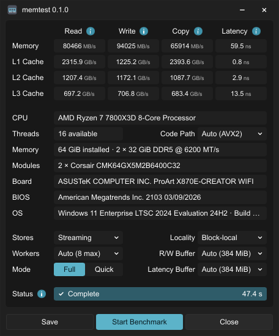

# memtest

An AIDA64-inspired memory and L1/L2/L3 cache benchmark: read, write, copy, and latency,
with a compact desktop window and a CLI. Rust for Windows, Linux, and macOS
on x86_64 and ARM64, using seeded access patterns and fixed run settings.



## Build and run

Requires Rust 1.99 and a native linker. Linux desktop builds also need
Fontconfig and X11/Wayland development libraries; see the [CI setup](.github/workflows/ci.yml).
Windows desktop builds need the Windows SDK (MSVC) or a full MinGW-w64 toolchain (GNU).

```sh
cargo run --release --locked
```

The executable is `target/release/memtest` (`memtest.exe` on Windows).
No arguments opens the window; `--cli` runs in the terminal. Benchmark flags
also select the CLI unless `--gui` is given.

## Usage

```sh
memtest --quick
memtest --gui --quick
memtest --json > results.json
memtest --level l2
memtest --threads 4 --size-mib 512 --latency-size-mib 512
memtest --isa sse2 --quick
memtest --stores cached --window-kib 0
memtest --save-profile reference.profile
memtest --level memory --profile reference.profile
```

Without flags, buffer sizes follow cache size and memory limits. Short pilot
runs select a worker count, then fresh samples measure performance. Explicit
worker counts and profiles skip selection. `--quick` is a short check; its small
RAM buffers may fit in cache. Buffer notes appear under Status in the GUI, in CLI
output, and in JSON's `warnings`. They use a conservative 4× reported-cache
reference and cannot certify RAM isolation. Apple's SLC is not reported,
so its coverage remains unknown. Use `--help` for all options.

Profiles save resolved RAM settings, store policy, and cache worker limits as plain
text; cache sizes follow each host.
Explicit flags override them; `--threads 0` selects workers again. Bandwidth size
is per stream, divided among workers; Copy allocates two such streams.
`--isa` selects `auto`, `sse2`, `avx2`, or `neon`. Unavailable implementations are
rejected. ISA and CPU placement are separate from the saved workload.
Use `--level memory` for RAM-only comparisons.

Double-click a result cell to run that test, or a row label to run all four.
Other scores stay in place. Save exports the full application window as a PNG,
including its shared title bar, icon, and version. Drag the title bar to move it.
The window shows installed memory, module names, motherboard, and BIOS details
when firmware exposes them. Reported memory rates are firmware configuration values.

The GUI uses Slint's software renderer with its default features disabled.
Build a CLI without third-party crates with `cargo build --release --locked --no-default-features`.
The desktop executable uses OS libraries; Linux needs a graphical desktop
and its font/window-system libraries, plus an XDG file chooser portal or Zenity
for screenshot saving. Project source is [MIT licensed](LICENSE).
Downloads include dependency notices generated for their target platform.

## Method

RAM reads use cached loads. Writes and copies default to non-temporal stores on
x86 and `STNP` hints on ARM; the ARM hint may be ignored. Streaming is a write
strategy, not a guarantee of cache bypass. RAM tests need working sets substantially
larger than the relevant caches in either mode.
`--stores cached` selects ordinary stores. Rates count useful bytes, excluding extra
bus traffic such as write allocation; Copy counts both reads and writes. Workers use
private buffers, initialized after CPU placement, with synchronized timing that
includes the kernels' store barriers.

RAM latency follows a seeded pointer chain with 128-byte spacing. The default
shuffles 2 MiB blocks and their nodes. `--window-kib 0` shuffles the whole buffer.
Page-local, block-local and full-random access measure different locality and translation costs.
Every sample traverses complete pointer cycles.
The touched cache-line footprint can be smaller than the allocated span when
pointer spacing exceeds the cache-line size; automatic latency sizing accounts
for this when the line size is known, and JSON reports the footprint separately.

Cache bandwidth uses cached stores and private worker buffers, bounded
by half each shared cache's capacity and sized above lower caches. Cache latency uses
one worker with a fully shuffled, half-capacity buffer and one pointer per cache line.
Lower-cache hits and translation costs still contribute. Unavailable levels are omitted.

By default, each test warms its buffer, calibrates toward 0.2 seconds per sample,
and reports the median of seven samples. Range is `100 × (maximum − minimum) / median`.

Bandwidth uses decimal MB/s (GB/s for cache displays); latency is ns per dependent
load. JSON includes settings, footprints, placement and ranges. CLI errors use stderr
and a nonzero exit code. Fixed settings preserve the workload across hosts; scheduling,
CPU placement, page policy and ISA still affect scores. Windows/Linux pin workers;
macOS uses OS scheduling. Scores are not directly equivalent to AIDA64.

`python3 scripts/memory-sweep.py <binary> <output-directory>` compares fixed-worker
cached and streaming runs at increasing sizes, saving raw JSON and a summary.
The same optional sweep is available when running CI manually.

<a href="https://slint.dev"></a>
